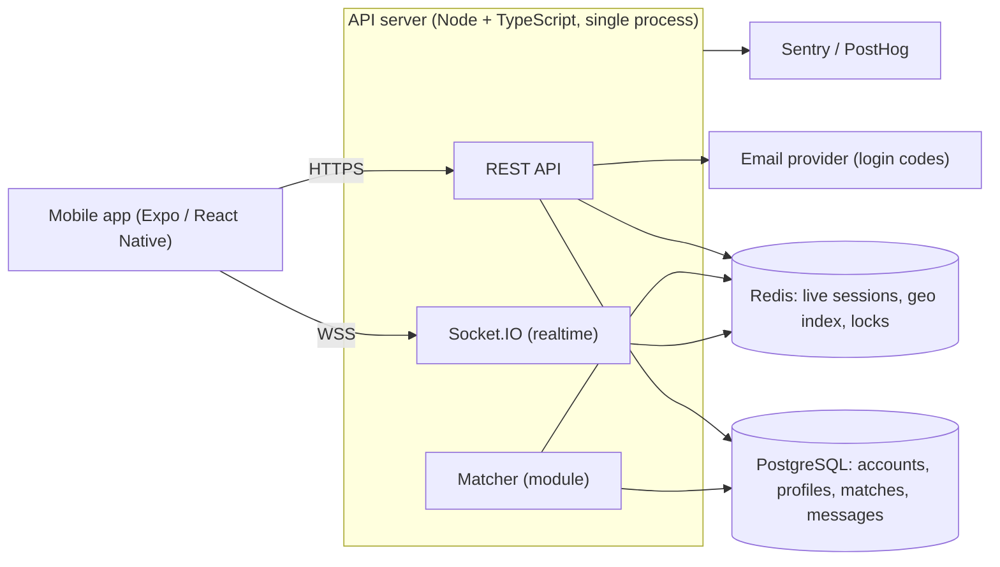

# docs/spec/architecture.md: System architecture (v1 pilot)

Scope: how the pieces fit together and why, sized for the Concordia pilot (target: 500 registered users, 50 concurrent live users), with a documented path to scale. Requirement IDs refer to `requirements.md`.

## 1. Principles

1. **Start simple, scale on evidence.** One API process, one Postgres, one Redis. Big apps (Uber, Tinder) also started with a single backend and a single database, and added partitioning only when growth forced it.
2. **Postgres is the source of truth; Redis is disposable.** Anything in Redis can be lost without losing accounts, matches or messages (NFR-6, NFR-7).
3. **Correctness before speed in matching.** A user is never in two matches (FR-20), enforced in the database, not just in application code.
4. **Design the keys for scaling now, build the scaling later.** Partition live state by institution from day one.

## 2. Components

| Component | Responsibility |
|---|---|
| Mobile app | UI, location permission, sends location, holds the WebSocket. Never talks to Postgres or Redis directly. |
| REST API | Auth, profiles, go live / go offline, match actions (decline, confirm), block, report, history. |
| Socket.IO | Pushes `match.proposed`, `match.updated`, `chat.message`; receives `chat.send`. |
| Matcher | A module inside the API process (not a separate service). Finds and proposes matches. |
| PostgreSQL | Durable data. Migrations only (NFR-27). |
| Redis | Live sessions with TTL, per-institution geo index, short-lived locks. |
| Email provider | Sends one-time login codes. |
| Sentry / PostHog | Errors and anonymous product metrics, no personal data (NFR-29, NFR-30). |

There is **no load balancer, queue, cache layer or separate worker** in v1. See section 11.

## 3. Redis data design

All live state is partitioned by `institutionId` (v1: one institution, but the keys already assume many).

| Key | Value | Lifetime |
|---|---|---|
| `live:session:{userId}` | JSON: radius, window end, institutionId, lastLat/Lng timestamp | TTL = time window |
| `live:geo:{institutionId}` | Geo set of live userIds (queried with `GEOSEARCH`) | Members removed explicitly |
| `claim:{userId}` | Random token | TTL ~15 s (short claim lock, section 5) |
| `lock:matcher:{institutionId}` | Random token | TTL ~5 s (one matcher run at a time) |

**Gotcha:** geo set members do not expire when the session key's TTL expires. The matcher sweep (section 4) removes any member whose `live:session:{userId}` key no longer exists. Going offline and match confirmation remove the member immediately.

**Location policy:** coordinates are sent once at go-live and refreshed when a match is proposed. They live only in Redis, never in Postgres or logs (NFR-16, NFR-18).

## 4. The matcher

**Triggers (event-driven plus safety sweep):**
1. A user goes live.
2. A user declines a proposal and is still live.
3. A match expires or ends and a participant is still live.
4. A sweep every ~10 seconds per institution, which catches anything the events missed and cleans up stale geo members.

**One run, per institution:**
1. Acquire `lock:matcher:{institutionId}`. If it is held, skip (another run is in progress).
2. For each unmatched live user (oldest first): `GEOSEARCH` candidates within that user's radius, then filter in code.
3. Filters: pair distance within the *smaller* of the two radii, overlapping time windows, same institution, not blocked either way, not already in an active match, not previously declined this session, dietary compatibility.
4. Score candidates with the pure scoring function (`matching.md`); take the best above the minimum.
5. Try to claim the pair atomically (section 5). If the claim fails, try the next candidate.
6. On success, create the match and push `match.proposed` to both users.
7. Release the lock.

The scoring function and the filters are pure functions with no I/O, so they can be unit-tested exhaustively. The matcher is the thin layer that wires them to Redis and Postgres.

## 5. Atomic matching (Redis claim + database constraint)

Goal: never two active matches for one user (FR-20), even if two matcher runs overlap, or two proposals race.

**Layer 1: Redis claim (fast path).**
- For the pair (A, B), acquire `claim:{A}` and `claim:{B}` with `SET key token NX PX 15000`, always in sorted userId order to avoid deadlocks.
- If either fails, skip this pair.
- Release with a compare-and-delete (Lua script) so a slow run never deletes someone else's lock.

**Layer 2: Postgres constraint (source of truth).**
- Table `active_match_participants(user_id UNIQUE, match_id)`.
- In **one transaction**: insert the `matches` row, then insert both participant rows.
- A unique violation means one user is already matched: roll back, treat the pair as claimed, try the next candidate.
- When a match reaches a terminal state (`CONFIRMED`, `DECLINED`, `EXPIRED`), delete its participant rows in the same transaction as the status change.

The Redis lock reduces wasted work and contention. The database constraint is what actually guarantees correctness, so a bug or a lock expiring early can never create a double match.

## 6. Match lifecycle and expiry

States are defined in `matching.md`: `PROPOSED → CHATTING → CONFIRMED`, or `DECLINED` / `EXPIRED`.

- Every transition happens in one database transaction and is guarded by the current status (for example `UPDATE ... WHERE status = 'PROPOSED'`), so repeated or concurrent requests are harmless (idempotent).
- Proposals and chats expire after 10 minutes (FR-24). The sweep finds matches past `expires_at`, marks them `EXPIRED`, releases participants, and notifies users.
- Confirming requires both `confirmed_a_at` and `confirmed_b_at`; the second confirm moves the match to `CONFIRMED` and takes both users out of the live set.

## 7. Realtime (Socket.IO)

- The socket authenticates with the same JWT as REST on connect.
- Each connection joins the room `user:{id}`; each active match has the room `match:{id}`.
- Authorization is checked on every event: a user may only send to and receive from their own match (NFR-11).
- **Reconnect:** on reconnect, the app calls `GET /matches/current` and the server re-sends current state, so a dropped connection never leaves the UI stale (NFR-8). Messages are written to Postgres first, then emitted.
- Single process for the pilot. To run more than one API instance later, add the Socket.IO Redis adapter so events reach sockets on other instances (section 12).

## 8. Key flows

**Login:** app → `POST /auth/request-code` → server checks the email domain against `institutions`, stores a hashed code with expiry and attempt count, sends email. → `POST /auth/verify-code` → server verifies and returns a JWT.

**Go live:** app → `POST /live` (location, radius, window) → server validates, writes `live:session:{userId}` with TTL, adds the user to `live:geo:{institutionId}`, triggers the matcher.

**Match to confirm:** matcher claims a pair (section 5) → `match.proposed` pushed to both → users chat over sockets → each calls `POST /matches/:id/confirm` → second confirm sets `CONFIRMED`, removes both from live → both apps show the confirmed screen.

## 9. Environments, deployment and delivery

| Environment | Setup |
|---|---|
| Local | Docker Compose: Postgres and Redis. API and Expo run on the developer machine. |
| Production | One managed-platform project containing the API service, Postgres and Redis. |
| Staging | None for the pilot. Add later if needed. |

**Hosting (recommendation, confirm at deploy time):** Railway, because Postgres and Redis come as one-click services in the same project and deploys come straight from GitHub. Expect roughly a $5 to $10 per month Hobby plan for the pilot. Alternatives: Render (free instances sleep and take 30 to 60 seconds to wake, which breaks a live-matching app, so use a paid instance) or Fly.io (no free tier, more manual setup, self-managed Postgres). Verify current prices on the provider's pricing page before committing, since they change.

**CI/CD (GitHub Actions):**
1. On every push and pull request: install, lint, type check, tests against Postgres and Redis service containers, dependency audit (NFR-15, NFR-26).
2. On merge to `main` with green checks: deploy the API; run database migrations as a release step before the new version starts taking traffic.
3. Mobile: manual EAS builds and TestFlight / Android internal testing until the pilot.

**Secrets:** local `.env` (git-ignored, `.env.example` committed); platform variables for production; GitHub Actions secrets for CI. The API fails to start if a required variable is missing (NFR-14).

## 10. Failure behavior

| Failure | What happens | Why it is safe |
|---|---|---|
| API restarts | Sockets drop; apps reconnect and fetch current state. | State lives in Redis and Postgres, not in memory. |
| Redis restarts or loses data | Live sessions vanish; users must tap Go Live again. | Matches and messages are in Postgres; the matcher reconciles active matches on startup. |
| Postgres unavailable | Writes fail with errors; no proposals are made. | The matcher does nothing without the database. |
| Matcher crashes mid-run | The lock expires in about 5 seconds; the next trigger or sweep retries. | Claims are protected by TTL and the DB constraint. |
| Two runs overlap or a user acts at the same moment | One claim wins; the other skips. | Section 5. |
| Email provider down | Login codes fail; existing sessions still work. | Surface a clear error; retry later. |
| User loses connection mid-match | Match continues; unconfirmed matches still expire. | Server-side timers, not client timers. |

## 11. Deliberately not doing (and why)

| Not doing | Reason |
|---|---|
| Load balancer | One instance handles the pilot; the hosting platform already terminates HTTPS in front of it. |
| Microservices | One codebase and one deploy is easier to understand, test and debug. |
| Message queue / separate worker | The matcher is light and runs in-process; a Redis lock covers coordination. |
| Separate cache layer | Redis here holds live state, not cached copies of database data. |
| CDN | No static assets to serve; the app is bundled in the mobile build. |
| Elasticsearch / search engine | Tens of live users per institution; Redis geo plus an in-memory scan is plenty. |
| Multi-region, Kubernetes | Not needed at this scale; revisit only with real growth. |
| Staging environment | Extra cost and setup for a pilot; CI plus careful migrations is enough. |

## 12. Capacity estimate and scaling path

**Pilot load (back of envelope):** 50 concurrent live users means about 50 location writes per live window, a matcher sweep over at most a few dozen candidates every 10 seconds, and a few chat messages per second at peak. A single small instance handles this with large headroom.

| Pressure | First sign | Change |
|---|---|---|
| More users, one university | Matcher sweep takes noticeable time | Index candidates in a tighter structure (geohash or H3 cells) and only compare same-cell neighbors; shard `live:geo` by city or cell. |
| Many universities | One Redis becomes hot | Already partitioned by institution key; move large institutions to their own Redis instance. |
| More concurrent sockets | CPU or memory at the limit | Run several API instances; add the Socket.IO Redis adapter; sticky connections are handled by the platform. |
| Message volume grows | Postgres write load, large `messages` table | Index and partition `messages` by time; archive old chats; consider a store built for high write rates. |
| Matcher contention | Lock wait times grow | Split matcher runs per cell instead of per institution. |
| Need for ops confidence | Incidents hard to diagnose | Add a staging environment, structured tracing, alerting. |

## 13. Decisions log

| Decision | Choice | Alternatives considered |
|---|---|---|
| Matcher trigger | Events plus a ~10 s sweep | Events only (a missed trigger strands users); timer only (slower proposals) |
| Atomicity | Redis claim plus database constraint | DB only (more contention); Redis only (not durable) |
| Location updates | Once at go-live, refreshed at proposal | Periodic heartbeat (battery and write cost) |
| Realtime transport | Socket.IO | Raw WebSockets (less built-in reconnect and rooms); |
| Matcher location | Module in the API process | Separate worker service |
| Hosting | Managed platform (Railway recommended) | Render, Fly.io, AWS |

## 14. Open items

- Reconcile this document with what Milestone 1 actually built (folder layout, commands, versions).
- Confirm the hosting platform and the real monthly budget (NFR-31).
- Choose the email provider.
- Decide the exact sweep interval and lock TTLs after measuring on real hardware.